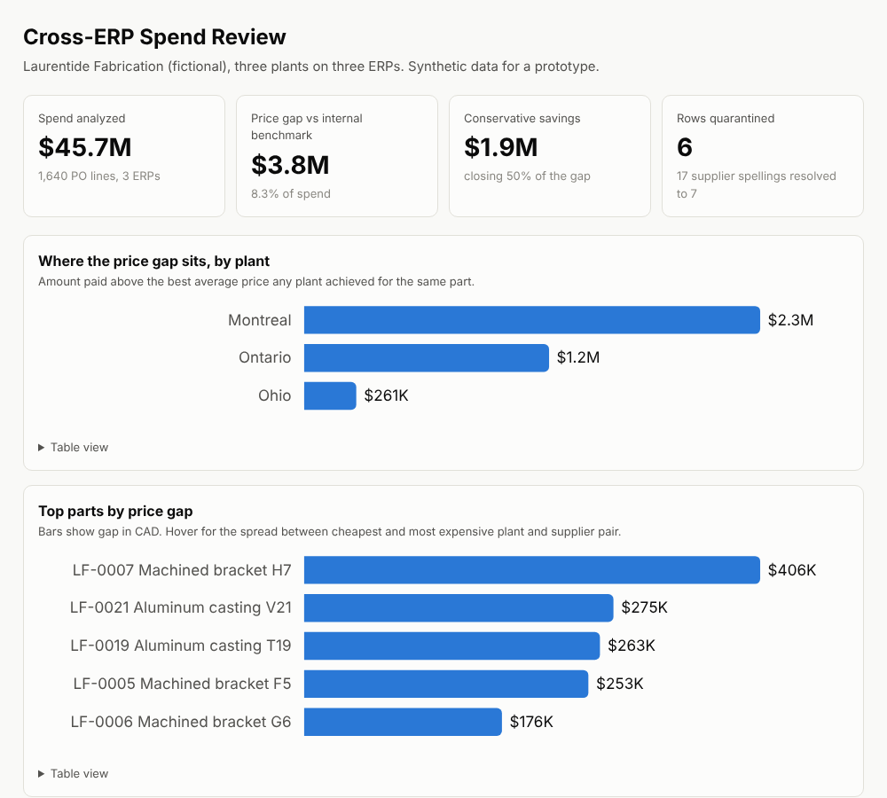

# Cross-ERP Spend Review: a 0→1 procurement data prototype

A manufacturer with three plants runs three ERPs. Same parts, different part
numbers, different currencies, supplier names typed five different ways. Nobody
can answer a simple question: **are we paying different prices for the same
part, and how much is that costing us?**

This prototype goes from raw ERP exports to an executive-ready answer:

```
3 ERP exports ──► normalize + resolve suppliers ──► quarantine bad rows
                          │
                          ▼
                   SQL metric views (DuckDB) ──► metrics.json
                          │                          │
                          ▼                          ▼
                  savings dashboard          Claude drafts exec memo
                                                     │
                                                     ▼
                                   grounding check: every figure must
                                   trace back to metrics.json
```

**Result on the synthetic dataset:** $45.7M of custom-part spend, a $3.8M
price-harmonization gap (8.3%), $1.9M conservative savings, concentration risk
on one supplier holding 30.4% of spend, and one supplier delivering on time
72.5% of the time.



## What it does

| Stage | File | Notes |
|---|---|---|
| Synthetic data | `generate_data.py` | SAP-style (Montreal, CAD, YYYYMMDD), Epicor-style (Ohio, USD, MM/DD/YYYY), spreadsheet (Ontario, free-text headers). Seeded, reproducible. Bad rows injected on purpose. |
| Normalize | `spend/normalize.py` | One canonical schema. Part crosswalk, supplier name resolution (17 spellings → 7 suppliers), USD → CAD. |
| Quality rules | `spend/normalize.py` | R1 price, R2 qty, R3 dates, R4 currency, R5 part crosswalk, R6 duplicates. Failing rows go to a quarantine table with the rule and source row number. Nothing is silently dropped. |
| Metrics | `sql/analysis.sql`, `spend/analyze.py` | Plain SQL views: spend by plant, supplier share and HHI, single-source parts, price benchmark and gap, on-time delivery. Portable to Metabase or any BI tool. |
| Exec memo | `prompts/exec_memo.md`, `spend/memo.py` | Claude drafts a one-page memo from `metrics.json` only. |
| Grounding check | `spend/grounding.py` | Parses every figure in the memo with its unit and precision and confirms a metric rounds to it. An invented number blocks the memo. |
| Dashboard | `build_dashboard.py` | Self-contained HTML: KPI tiles, gap by plant, top parts, supplier share, on-time delivery, memo, quarantine log. Light and dark mode, hover tooltips, table view under each chart. |

## How the savings number is defined

- **Benchmark:** for each part, the lowest *average* unit price achieved by any
  plant and supplier pair with at least 3 purchase lines. One-off quotes can't
  set the benchmark.
- **Gap:** what each line paid above that benchmark, times quantity.
- **Conservative savings:** 50% of the gap (`CAPTURE_RATE` in `spend/analyze.py`).
  Not every contract can be renegotiated, so the headline is the defensible number.
- **FX:** fixed planning rate, 1 USD = 1.37 CAD (`spend/normalize.py`).
- The figures cover the period in the data and are not annualized.

## Run it

```bash
pip install -r requirements.txt
python generate_data.py          # writes data/raw and data/reference
python run_pipeline.py           # clean lines, quarantine, output/metrics.json
python -m spend.memo             # with ANTHROPIC_API_KEY: drafts + checks the memo
                                 # without: writes the filled prompt to output/memo_prompt.md
python -m spend.grounding examples/exec_memo_sample.md output/metrics.json
python build_dashboard.py        # output/dashboard.html
pytest -q                        # 9 tests
```

`examples/exec_memo_sample.md` is a memo Claude drafted from this prompt and
metrics. It passes the grounding check (31 figures, 0 ungrounded); change any
figure and it fails.

## Next steps if this proved out

- **Schedule it:** an n8n workflow that drops new ERP exports in, runs the
  pipeline, and emails the memo and dashboard to the plant managers each month.
- **Ask it questions:** expose the SQL views to Claude through an MCP server so a
  buyer can ask "what did Montreal pay for LF-0007 last quarter vs Ohio?"
- **Fuzzy supplier matching** beyond the rules + alias table, with human review
  of low-confidence matches.
- **Hand-off:** the canonical schema, rules and metric definitions above are the
  spec a product team would rebuild against.

All data is synthetic. Laurentide Fabrication and every supplier named here are fictional.
